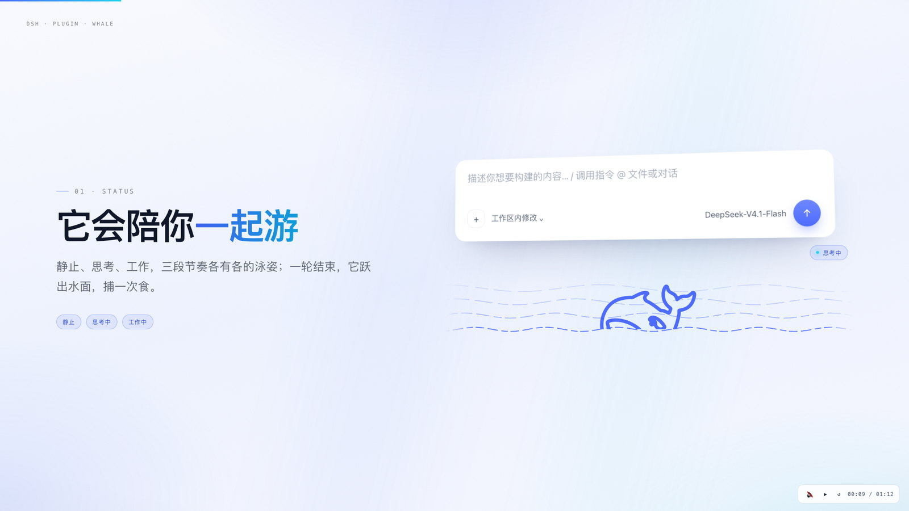
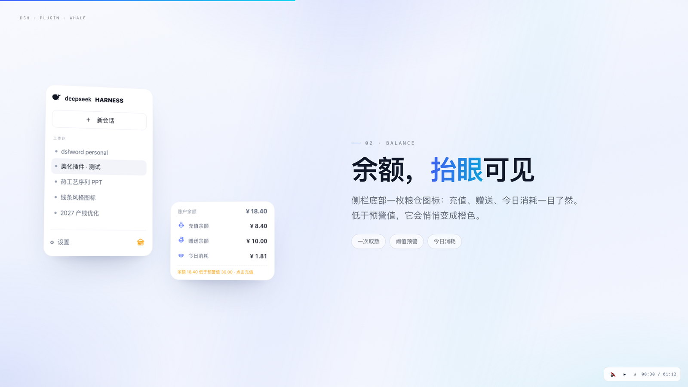
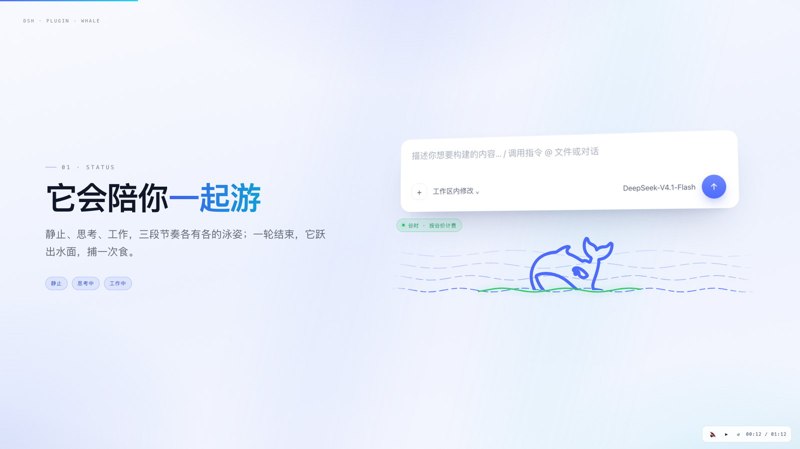
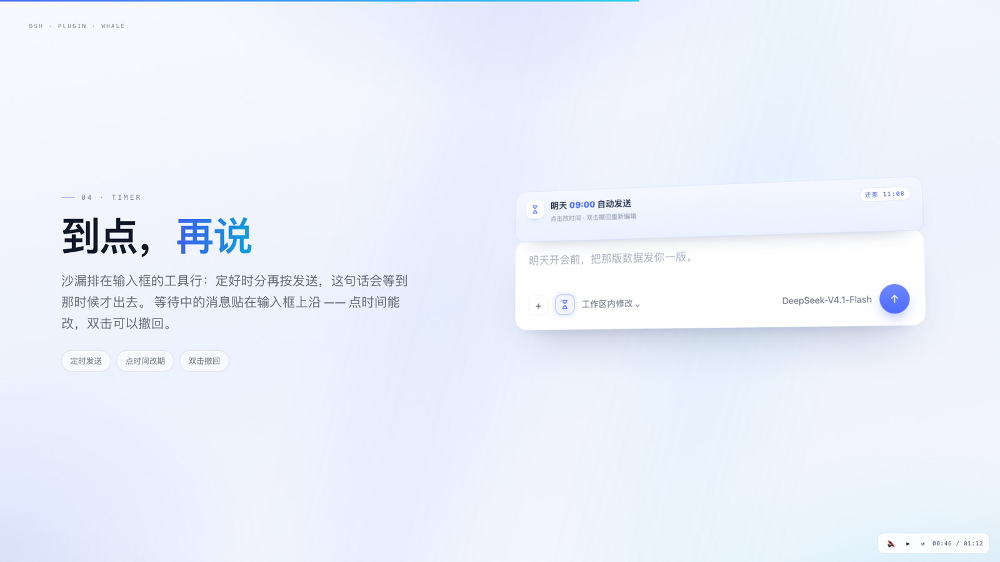
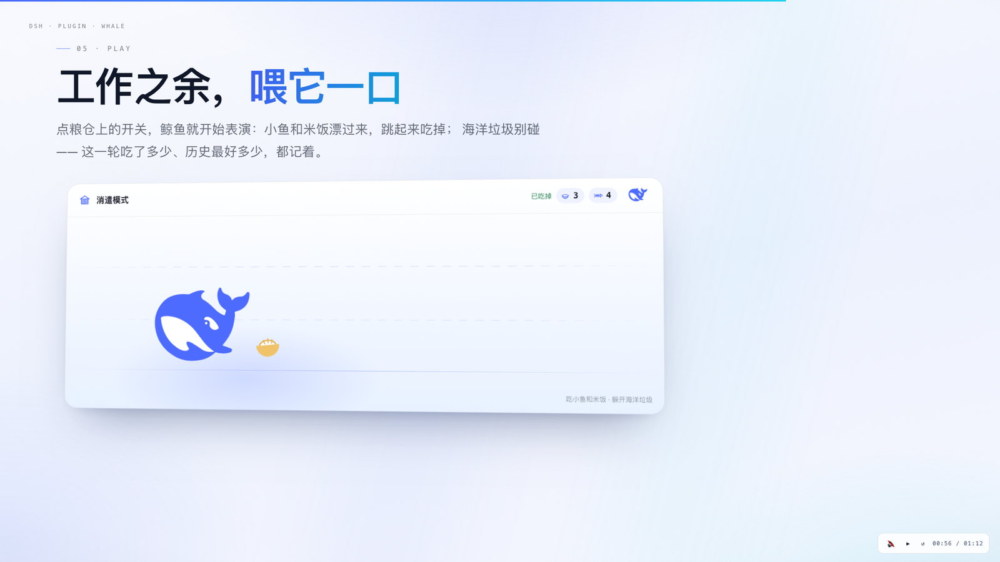

# dsh-plugin-whale

**给 DSH 的对话界面，加一条鲸鱼。** 一条会跟着会话状态游动的鲸鱼、一只替你算清每一分钱的粮仓，
外加一个到点才把话发出去的沙漏 —— 全部长成 DSH 自己的样子，不像外挂。

<p align="center">
  
</p>

> DeepSeek Harness 还处在 developer preview，插件 API 会变。本插件按 **0.2.x** 的客户端接口实现，
> 升级 DSH 后如果某个位置错位，请提 issue。

## 它做了什么

| | 功能 | 在哪 |
|---|---|---|
| 🐋 | **鲸鱼状态条**：静止 / 思考中 / 工作中三种泳姿，一轮回答结束后跃出水面捕一次食 | 输入框下方（占满整行） |
| 🏺 | **余额粮仓**：点一下展开充值、赠送、今日消耗；低于预警值图标变橙 | 侧栏底部、账户行上方 |
| 🌊 | **峰谷谷价**：谷时随机点亮一段海面为绿色（单向匀速、亮度可调），峰时消失 | 鲸鱼条 |
| 💸 | **用量与金额**：Token 用量面板里多一行按官方价目、峰谷分时算出的消耗金额 | 用量面板 |
| 🎮 | **消遣模式**：小鱼和米饭从右往左漂，点鲸鱼跃起接住；海洋垃圾别碰。记录本轮与历史最高 | 粮仓弹层里的鲸鱼开关 |
| ⏳ | **定时发送**：沙漏设定时分，到点才发；等待中的消息吸附在输入框上沿，点时间改期、双击撤回 | 输入框工具行 |
| ⚙️ | **设置**：余额预警阈值、绿色亮度、鲸鱼缩放、鲸鱼风格（线稿 / 填色）、零食速度、诊断开关 | 设置 → 余额与用量 |

<table>
  <tr>
    <td width="50%"></td>
    <td width="50%"></td>
  </tr>
  <tr>
    <td width="50%"></td>
    <td width="50%"></td>
  </tr>
</table>

## 安装

需要已经装好 DeepSeek Harness（`dsh`，桌面版或 `npx @deepseek-ai/dsh web` 都行）。

```sh
# 从 npm（已发布时）
dsh plugin add dsh-plugin-whale

# 直接从 GitHub
dsh plugin add github:<your-name>/dsh-plugin-whale
```

装完重启 DSH，输入框下方会出现鲸鱼条，侧栏账户行上方多出粮仓图标。

如果 `dsh plugin` 提示需要 profile，加上你自己的：`dsh plugin --profile desktop add dsh-plugin-whale`。

## 用起来

1. **看状态**：鲸鱼条会跟着会话走 —— 空闲时慢慢游，思考时摆尾变慢，执行命令时加速；
   一轮回答结束会跃出水面吃一条小鱼。
2. **看钱**：点侧栏的粮仓图标，展开余额；总余额低于阈值（默认 30 元）时图标从蓝变橙。
   把鼠标停在金额上可以看拆解：峰/谷各花了多少、按哪档单价算的。
3. **定时**：点输入框工具行里的沙漏，选好时、分，按「定时发送」；这条消息会挂在输入框上沿，
   到点自动发出。点时间可以改期，双击可以撤回重新编辑。
4. **玩**：打开粮仓弹层，点那枚鲸鱼图标开启消遣模式；再点一次结束。

## 它不做什么

- **不碰你的密钥**：纯前端插件，余额与用量只通过宿主已有的账户接口读取，不写任何账号信息；
  本地只缓存「上次余额」用于首屏占位。
- **不上传数据**：没有远程请求，唯一的外链是官方定价页（用来核对价目）。
- **不算平台账单**：消耗金额是按官方价目 × 本地 token 增量估算的，用于「心里有数」，不是对账工具。

## 兼容性

| DSH | 状态 |
|---|---|
| 0.2.1（desktop / web） | 已验证：鲸鱼条、粮仓、预警、峰谷、用量金额、消遣模式、定时发送 |
| 0.2.0 | 基本可用，个别插槽 DOM 有差异 |
| 0.1.x | 未适配 |

## 开发

```sh
pnpm install
python3 build_plugin.py        # src/client.js + 资源 → lib/client.js
```

- `lib/index.js` —— 宿主半边：只声明配置 schema（`whaleScale` / `alertThreshold` / `greenBrightness` /
  `snackSpeed` / `showDiagnostics` / `whaleStyle`）。
- `lib/client.js` —— 浏览器半边：所有 UI 都在这里，单文件、无运行时依赖（除 `@deepseek-ai/schemastery`）。
- `cordis.patch.yml` —— 作为 bundle 层挂进 profile 的补丁。

改完把 `lib/` 一起提交，用户端不需要自己构建。

## 宣传片

72 秒、4K60 的成片在 [Releases](../../releases) 里（`宣传片-4K60.mp4`），
也有一版可以直接在浏览器里播的 HTML。

## 许可

[MIT](LICENSE) © 2026
